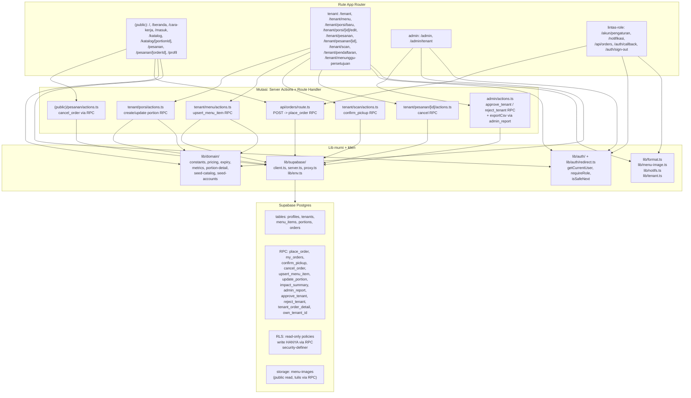
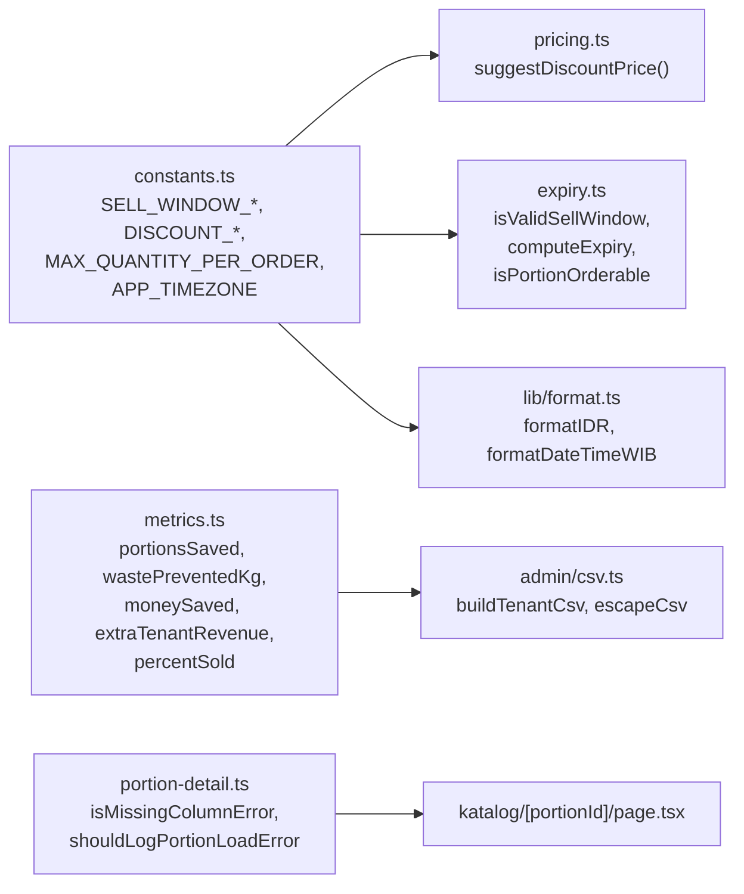
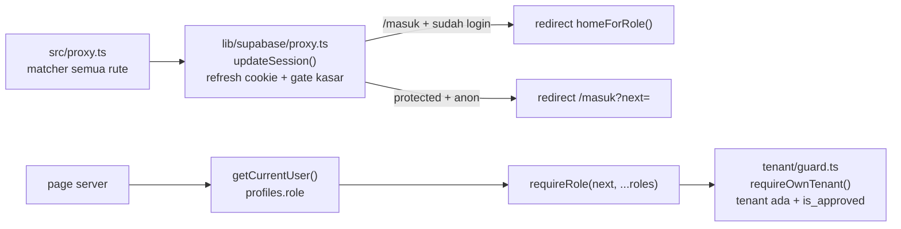

# Code Graph — Seporsi Terakhir

Graf dependensi kode per 30 Okt 2026 (branch `dev-redesign`). Fokus: `src/` + `supabase/migrations/`. UI shadcn (`src/components/ui/*`) adalah leaf, tidak digambar per-komponen.

## 1. Lapisan (layer diagram)

## 2. Dependensi lib/domain (murni, tanpa I/O)

Aturan: `lib/domain/*` tidak boleh import `supabase`, `next/*`, atau `lib/auth`. Validasi Zod di boundary (form + actions + route) memakai konstanta ini.

## 3. Auth & guard chain

`proxy.ts` hanya cek ada/tidaknya user (cepat). Pengecekan role ketat ada di tiap `page.tsx` / `guard.ts` server-side.

## 4. Alur data utama

| Alur | Rute → Aksi → RPC → Tabel |
|---|---|
| Student order | `/katalog/[portionId]` order-form → `POST /api/orders` → `place_order` → `orders` insert + `portions.quantity_remaining` decrement atomik |
| Batal (student) | `/pesanan/[orderId]` cancel-button → `(public)/pesanan/actions.ts` → `cancel_order` → `orders.status=cancelled`, kuota kembali |
| Tenant posting | `/tenant/porsi/baru` portion-form → `tenant/porsi/actions.ts` → `create_portion` / `update_portion` → `portions` |
| Tenant menu | `/tenant/menu` menu-manager → `tenant/menu/actions.ts` → `upsert_menu_item` → `menu_items` (+ `image_path` via `menu-images` bucket) |
| Scan pickup | `/tenant/scan` scanner-client → `tenant/scan/actions.ts` → `confirm_pickup(pickup_token)` → `orders.status=picked_up` |
| Admin approve | `/admin/tenant` approve-list → `admin/actions.ts` → `approve_tenant` / `reject_tenant` → `tenants.is_approved` + `profiles.role` promosi |
| Admin laporan | `/admin` impact-client → `impact_summary` + `admin_report` → `admin/csv.ts buildTenantCsv` → unduh CSV |
| Notifikasi | `/notifikasi` + `notif-live.tsx` → `lib/notifs.ts loadNotifs(role)` → `my_orders` (student) / `orders` join (tenant) / `tenants pending` (admin), live via Realtime `orders` |

## 5. Tabel modul kunci

| Modul | Tanggung jawab | Bergantung ke | Dipakai oleh |
|---|---|---|---|
| `lib/domain/constants.ts` | BR-2/BR-6 single source of truth | — | pricing, expiry, format, actions, route |
| `lib/domain/pricing.ts` | saran harga 45% → Rp500 | constants | portion-form, menu-manager |
| `lib/domain/expiry.ts` | validasi window + orderability | constants | katalog-list, order-form, API route |
| `lib/domain/metrics.ts` | 5 metrik impact | — | admin impact-client, csv |
| `lib/auth/*` | getCurrentUser, requireRole, isSafeNext | supabase/server | semua page terproteksi, proxy |
| `lib/supabase/*` | client/server/proxy, refresh sesi | env (Zod) | actions, route, pages |
| `lib/notifs.ts` | agregasi notif per role | supabase/server | /notifikasi |
| `lib/tenant.ts` | getOwnTenant | auth, supabase/server | tenant guard + pages |
| `lib/menu-image.ts` | public URL `menu-images` | env | katalog, detail, menu-manager |
| `app/admin/csv.ts` | build + escape CSV (anti formula-inject) | metrics | admin/actions exportCsv |
| `proxy.ts` | entry middleware | lib/supabase/proxy | Next.js |

## 6. Catatan regenerasi

Graf ini dibuat manual dari baca kode (bukan generated tool). Untuk regenerasi otomatis parsial: `find src/app -name "page.tsx" -o -name "actions.ts" -o -name "route.ts"` untuk daftar rute, dan `head` tiap file `supabase/migrations/*.sql` untuk RPC baru. Jika tambah RPC/route baru, update tabel §4 + diagram §1 di file ini.
