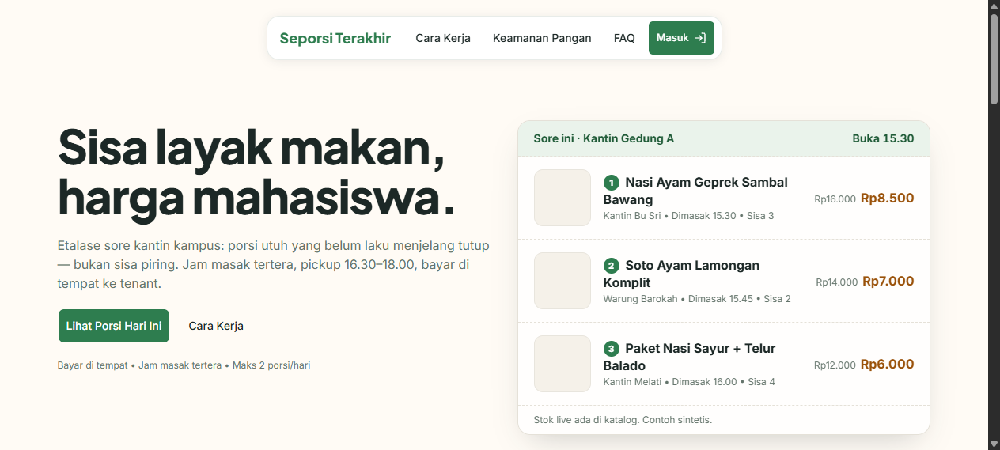
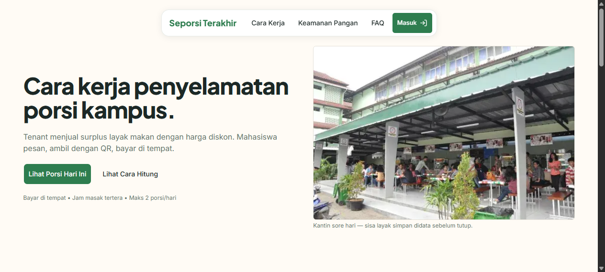
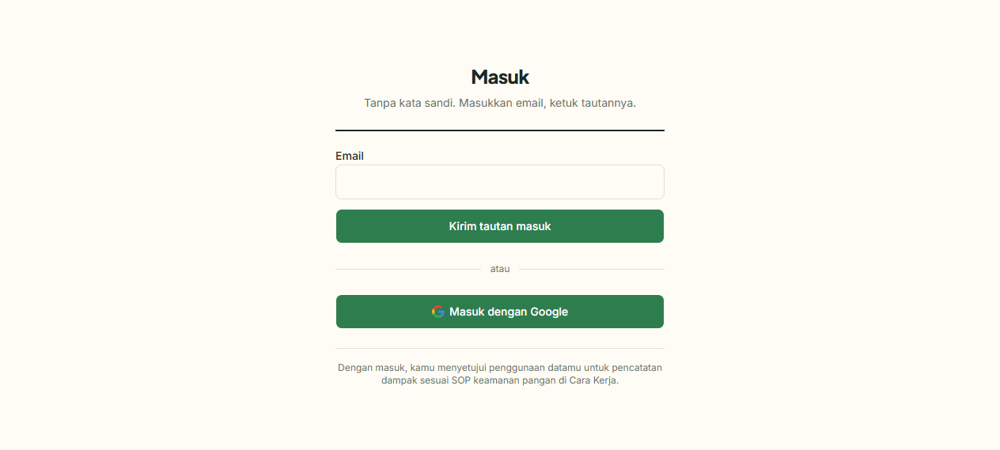

# Eksplorasi QA — 30 Okt 2026 (sesi corrector)

Sesi eksplorasi headless (browser milik agen, layar user tidak disentuh) terhadap
`http://localhost:3001` + pembanding tunnel `https://re.seporsi-terakhir.my.id`.
Tujuan: peta rute, parity tunnel, audit UI/UX halaman publik, dan uji alur login magic-link.

## 1. Landing `/` (lokal, 200)

Hero dua kolom di kanvas krem: headline "Sisa layak makan, harga mahasiswa",
CTA "Lihat Porsi Hari Ini" + link "Cara Kerja", microcopy "Bayar di tempat •
Jam masak tertera • Maks 2 porsi/hari". Kartu etalase "Sore ini • Kantin Gedung A"
menampilkan 3 contoh porsi (Geprek Rp8.500, Soto Rp7.000, Sayur+Telur Rp6.000)
dengan footer "Stok live ada di katalog. Contoh sintetis."

Temuan UI/UX:
- Foto ketiga menu kosong (kotak beige) — terbaca seperti loading rusak.
- Harga coret kontras tipis, tidak ada badge hemat (-%).
- Copy bocor bahasa dev: "Contoh sintetis", "Stok live", "pickup", "Sisa 3" tanpa satuan,
  jam tanpa WIB.
- CTA sekunder "Cara Kerja" tanpa affordance klik + duplikat nav.

## 2. `/cara-kerja` (lokal, 200)

H1 "Cara kerja penyelamatan porsi kampus." Langkah 1-2-3 (unggah → pesan/QR →
ambil/bayar), 5 kartu metrik dampak (porsi, kg, hemat, omzet, % laku),
batas jual 120–240 menit. Render penuh, tidak ada yang blank.

## 3. `/masuk` (lokal, 200)

Magic-link only: field Email + "Kirim tautan masuk" + "atau" + "Masuk dengan Google".
Catatan: decisions.md menyebut login email+password, tapi yang ke-render hanya
magic-link — perlu verifikasi (mungkin form password ada di bawah lipatan).

Temuan UI/UX:
- Tombol Google hijau tua + logo G warna-warni (kontras mati, langgar panduan Google).
- Dua tombol primer identik, tanpa hierarki.
- Tombol kirim aktif saat email kosong (validasi hanya saat submit).
- Garis hitam tebal di bawah subjudul terlihat seperti bug `
`.
- Nol branding di halaman login — berisiko terlihat seperti phishing.

## 4. Guard rute (19 rute diuji)

Semua rute proteksi redirect tepat ke `/masuk?next=<rute>`: /beranda, /katalog,
/pesanan, /profil, /tenant, /tenant/menu, /tenant/porsi/baru, /tenant/pesanan,
/tenant/scan, /tenant/pendaftaran, /tenant/menunggu-persetujuan, /admin,
/admin/tenant, /notifikasi, /akun/pengaturan. Publik yang lolos langsung:
`/`, `/cara-kerja`, `/masuk`. `GET /api/orders` 405 (POST-only, wajar).

## 5. Parity tunnel

`re.seporsi-terakhir.my.id` → 200, heading + body identik dengan lokal.
Tunnel meneruskan ke server yang benar.

## 6. Uji login magic-link (TERHENTI di tengah)

- Isi `seporsi-qa-301026@yopmail.com` → submit → status "Mengirim…" → sukses:
  "Tautan masuk terkirim … Buka email lalu ketuk tautannya." + tombol Kirim ulang / Ganti email.
- Inbox Yopmail dibuka, tetapi daftar email tertutup dinding "Please confirm
  you're human to continue" (bot check) — email tidak bisa dibaca, link tidak bisa diklik.
- Rute login (/beranda, /katalog, /profil, /pesanan, /tenant/*, /admin/*)
  BELUM teruji. Lanjutan butuh salah satu: klik manual tautan di inbox asli,
  akun uji dengan password, atau OTP via Supabase dashboard.
